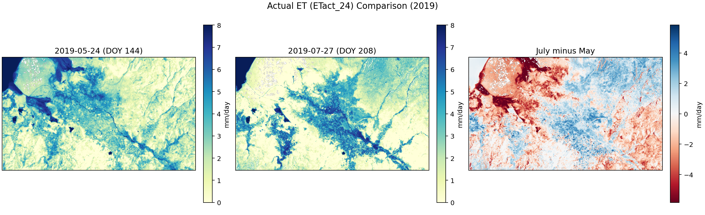
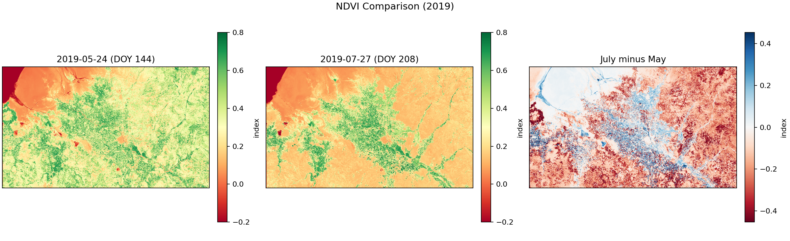
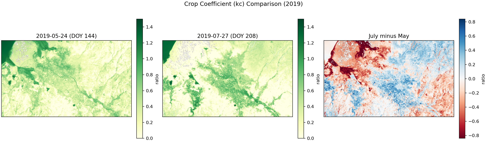
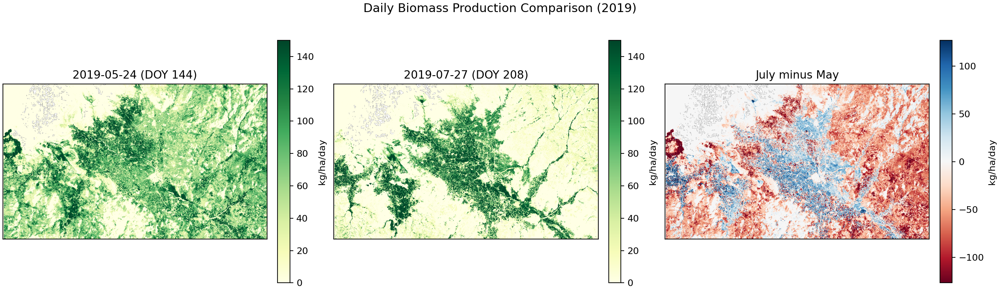

# PySEBAL ET & NDVI Pipeline

A step-by-step Python workflow to calculate **Evapotranspiration (ET)**, **Biomass**, and **NDVI** using **PySEBAL**, followed by monthly averaging, spatio-temporal gap-filling, and seasonal/annual aggregation.

## Workflow Overview
1. **Input Data Acquisition:** Satellite imagery (e.g., Landsat), DEM, meteorological data, and soil data.
2. **PySEBAL Processing:** Per-image calculation of ET, NDVI, and Biomass.
3. **Post-Processing:** Monthly maps, spatio-temporal gap-filling, and seasonal/annual aggregation.

## Input Data & Sources

| Input Dataset | Role in Pipeline | Spatial / Temporal Details | Source |
| :--- | :--- | :--- | :--- |
| **Landsat 8 Collection 2 Level-1 (`L1TP`)** | Surface reflectance, `NDVI`, thermal bands, and PySEBAL energy balance (`ETact_24`, `kc`, `Biomass_production`) | Path/row `168034`, 30 m (`2019-05-24` / DOY 144 & `2019-07-27` / DOY 208) | USGS EarthExplorer / NASA Earthdata |
| **SRTM Digital Elevation Model (`srtm_30m.tif`)** | Elevation, slope/aspect, and terrain radiation/lapse-rate adjustments | ~30 m resolution, warped/aligned to `WGS 84 / UTM zone 38N` | NASA SRTM / USGS EarthExplorer |
| **GLDAS Noah Land Surface Model** | Instantaneous and 24-hour air temperature (`Tair`), relative humidity (`Rh`), wind speed (`Wind`), and incoming shortwave radiation (`SWdown`) | 3-hourly / daily meteorological inputs interpolated per scene and warped to 30 m UTM Zone 38N | NASA GES DISC (`GLDAS_NOAH025_3H`) |
| **Soil Moisture & Hydraulic Rasters** | Saturated (`wcsat`), residual (`wcres`), field capacity (`wcpf2`), and wilting point (`wcpf4.2`) topsoil/subsoil layers for root-zone and biomass modules | Gap-filled and aligned to the reference grid for PySEBAL soil/biomass modules | SoilGrids / derived soil hydraulic rasters |

## Repository Structure
- `config/` – Configuration settings (study area, dates, paths)
- `src/` – Python scripts for preprocessing, PySEBAL execution, and post-processing
- `data/` – Local data folder (ignored by Git)

## Status
Work in progress — building step by step.

## Scripts (`src/`)
- `src/01_check_ndvi.py` — Reads Red and NIR rasters to verify geospatial setup and compute NDVI.
- `src/03_prepare_pysebal_run.py` — Generates `data/processed/pysebal_run.xlsx` from `config/config.yaml` and runs `PySEBAL_dev` (`SEBALcode`) to generate ET, vegetation/NDVI, and biomass rasters.

## Single-Scene Example (`2019-05-24`)

End-to-end test run on a 30 m Landsat 8 Collection 2 Level-1 scene over path/row `168034` (`DOY 144`) using `data/raw/srtm_30m.tif` in `pysebal_env`.

### Run Command
`python src\03_prepare_pysebal_run.py --run`

### Sample Output Metrics (`2019-05-24`, `DOY 144`)
Generated rasters are written locally under `data/outputs/pysebal_run/` (ignored in Git via `.gitignore`).

| Output Raster | Variable | Min | Mean | Max |
| :--- | :--- | :--- | :--- | :--- |
| `L8_ETact_24_30m_2019_05_24_144.tif` | Daily Actual ET (`mm/day`) | `0.000` | `3.591` | `10.139` |
| `L8_NDVI_30m_2019_05_24_144.tif` | NDVI | `-0.477` | `0.326` | `0.805` |

## Scripts (`src/`)
- `src/01_check_ndvi.py` — Reads Red and NIR rasters to verify geospatial setup and compute NDVI.
- `src/03_prepare_pysebal_run.py` — Generates `data/processed/pysebal_run.xlsx` from `config/config.yaml` and runs `PySEBAL_dev` (`SEBALcode`) to generate ET, vegetation/NDVI, and biomass rasters.

## Single-Scene Example (`2019-05-24`)

End-to-end test run on a 30 m Landsat 8 Collection 2 Level-1 scene over path/row `168034` (`DOY 144`) using `data/raw/srtm_30m.tif` in `pysebal_env`.

### Run Command
`python src\03_prepare_pysebal_run.py --run`

### Sample Output Metrics (`2019-05-24`, `DOY 144`)
Generated rasters are written locally under `data/outputs/pysebal_run/` (ignored in Git via `.gitignore`).

| Output Raster | Variable | Min | Mean | Max |
| :--- | :--- | :--- | :--- | :--- |
| `L8_ETact_24_30m_2019_05_24_144.tif` | Daily Actual ET (`mm/day`) | `0.000` | `3.591` | `10.139` |
| `L8_NDVI_30m_2019_05_24_144.tif` | NDVI | `-0.477` | `0.326` | `0.805` |

## Scripts (`src/`)
- `src/01_check_ndvi.py` — Reads Red and NIR rasters to verify geospatial setup and compute NDVI.
- `src/03_prepare_pysebal_run.py` — Generates `data/processed/pysebal_run.xlsx` from `config/config.yaml` and runs `PySEBAL_dev` (`SEBALcode`) to generate ET, vegetation/NDVI, and biomass rasters.

## Single-Scene Example (`2019-05-24`)

End-to-end test run on a 30 m Landsat 8 Collection 2 Level-1 scene over path/row `168034` (`DOY 144`) using `data/raw/srtm_30m.tif` in `pysebal_env`.

### Run Command
`python src\03_prepare_pysebal_run.py --run`

### Sample Output Metrics (`2019-05-24`, `DOY 144`)
Generated rasters are written locally under `data/outputs/pysebal_run/` (ignored in Git via `.gitignore`).

| Output Raster | Variable | Min | Mean | Max |
| :--- | :--- | :--- | :--- | :--- |
| `L8_ETact_24_30m_2019_05_24_144.tif` | Daily Actual ET (`mm/day`) | `0.000` | `3.591` | `10.139` |
| `L8_NDVI_30m_2019_05_24_144.tif` | NDVI | `-0.477` | `0.326` | `0.805` |

## Post-Processing & Multi-Scene Comparison (`2019-05-24` & `2019-07-27`)
- `src/04_postprocess_et_ndvi.py` — Performs temporal and spatial gap-filling and aggregates rasters into monthly, seasonal, and annual composites plus `data/outputs/postprocessed/postprocessing_summary.csv`.

| Variable | Period / Composite | Min | Mean | Max |
| :--- | :--- | :--- | :--- | :--- |
| `ETact_24` | `2019-05` / `2019-MAM` (`mm/day`) | `0.0000` | `3.5711` | `10.1395` |
| `ETact_24` | `2019-07` / `2019-JJA` (`mm/day`) | `0.0000` | `2.2991` | `8.8687` |
| `ETact_24` | `2019` Annual Mean (`mm/day`) | `0.0000` | `2.7231` | `8.8687` |
| `NDVI` | `2019-05` / `2019-MAM` | `-0.4769` | `0.3256` | `0.8051` |
| `NDVI` | `2019-07` / `2019-JJA` | `-0.6415` | `0.2260` | `0.8537` |
| `NDVI` | `2019` Annual Mean | `-0.4861` | `0.2592` | `0.8240` |

## Post-Processing & Multi-Scene Comparison (`2019-05-24` & `2019-07-27`)
- `src/04_postprocess_et_ndvi.py` — Performs temporal and spatial gap-filling and aggregates rasters into monthly, seasonal, and annual composites plus `data/outputs/postprocessed/postprocessing_summary.csv`.

| Variable | Period / Composite | Min | Mean | Max |
| :--- | :--- | :--- | :--- | :--- |
| `ETact_24` | `2019-05` / `2019-MAM` (`mm/day`) | `0.0000` | `3.5711` | `10.1395` |
| `ETact_24` | `2019-07` / `2019-JJA` (`mm/day`) | `0.0000` | `2.2991` | `8.8687` |
| `ETact_24` | `2019` Annual Mean (`mm/day`) | `0.0000` | `2.7231` | `8.8687` |
| `NDVI` | `2019-05` / `2019-MAM` | `-0.4769` | `0.3256` | `0.8051` |
| `NDVI` | `2019-07` / `2019-JJA` | `-0.6415` | `0.2260` | `0.8537` |
| `NDVI` | `2019` Annual Mean | `-0.4861` | `0.2592` | `0.8240` |

## Environment & Dependencies
- Install core Python dependencies via `pip install -r requirements.txt` (including `matplotlib` for `src/05_plot_comparison.py`).
- On Windows with Anaconda, install `gdal` and `rasterio` from `conda-forge` inside your dedicated environment (`pysebal_env`), and prepend `<env>\Library\bin` to `PATH` / DLL search path if external GIS software (such as QGIS) is installed.

## Meteo & Soil Moisture Alignment + Updated Two-Scene Results (`2019-05-24` & `2019-07-27`)
- `src/02_align_inputs.py` — Warps and resamples coarse WGS 84 GLDAS meteorological (`Tair`, `Rh`, `Wind`, `SWdown`) and soil moisture (`wcsat`, `wcres`, `wcpf2`, `wcpf4.2`) GeoTIFFs into `data/processed/aligned/` on the projected Landsat grid (`WGS 84 / UTM zone 38N`), wired per scene via `config/config.yaml` and `src/03_prepare_pysebal_run.py`.

| Variable | Period / Composite | Min | Mean | Max |
| :--- | :--- | :--- | :--- | :--- |
| `ETact_24` | `2019-05` / `2019-MAM` (`mm/day`) | `0.0000` | `2.4318` | `11.8210` |
| `ETact_24` | `2019-07` / `2019-JJA` (`mm/day`) | `0.0000` | `2.0250` | `12.0659` |
| `ETact_24` | `2019` Annual Mean (`mm/day`) | `0.0000` | `2.2962` | `11.5284` |
| `ETact_24` | `2019` Annual Est. 365d (`mm/yr`) | `0.0000` | `838.1013` | `4207.8745` |
| `NDVI` | `2019-05` / `2019-MAM` | `-0.4769` | `0.3256` | `0.8051` |
| `NDVI` | `2019-07` / `2019-JJA` | `-0.6415` | `0.2260` | `0.8537` |
| `NDVI` | `2019` Annual Mean | `-0.4628` | `0.2924` | `0.8099` |

## Crop Coefficient (`kc`) & Daily Biomass Production (`2019-05-24` & `2019-07-27`)
- Extended `src/04_postprocess_et_ndvi.py` and `src/05_plot_comparison.py` to generate monthly, seasonal, and annual composites plus May vs. July comparison figures (`kc_may_vs_jul_2019.png` and `biomass_production_may_vs_jul_2019.png`).

| Variable | Period / Composite | Min | Mean | Max |
| :--- | :--- | :--- | :--- | :--- |
| `kc` | `2019-05` / `2019-MAM` (`ratio`) | `0.0000` | `0.3341` | `1.8547` |
| `kc` | `2019-07` / `2019-JJA` (`ratio`) | `0.0000` | `0.2827` | `1.7950` |
| `kc` | `2019` Annual Mean (`ratio`) | `0.0000` | `0.3170` | `1.7767` |
| `Biomass_production` | `2019-05` / `2019-MAM` (`kg/ha/day`) | `-1.0296` | `52.1406` | `193.9844` |
| `Biomass_production` | `2019-07` / `2019-JJA` (`kg/ha/day`) | `-1.0715` | `33.0789` | `227.9762` |
| `Biomass_production` | `2019` Annual Mean (`kg/ha/day`) | `-0.9402` | `45.7867` | `196.8079` |

### Study Area: Miandoab Irrigation Scheme & Lake Urmia Basin
The workflow covers Landsat 8 path/row `168034` (`WGS 84 / UTM zone 38N`, 30 m) encompassing the **Miandoab Irrigation Scheme** in the **Lake Urmia** basin, where irrigated agriculture and water allocation are closely tied to basin water stress and the long-term shrinking of Lake Urmia. Comparing May (`2019-05-24`, DOY 144) and July (`2019-07-27`, DOY 208) illustrates seasonal shifts in crop water consumption (`ETact_24`), crop coefficient (`kc`), greenness (`NDVI`), and daily biomass production across irrigated and surrounding landscapes.

### May vs. July 2019 Comparison Figures




### May vs. July 2019 Comparison Figures


## Author & Citation
- **Author:** Omar Mohamed ([@omo2021](https://github.com/omo2021))
- **License:** MIT (see [`LICENSE`](LICENSE))

If you use this repository or workflow in your research, please cite:

```bibtex
@software{Mohamed_PySEBAL_Pipeline_2026,
  author = {Mohamed, Omar},
  title = {{PySEBAL Evapotranspiration and NDVI Pipeline}},
  year = {2026},
  version = {1.0.0},
  url = {[https://github.com/omo2021/pysebal-et-ndvi-pipeline](https://github.com/omo2021/pysebal-et-ndvi-pipeline)}
}
